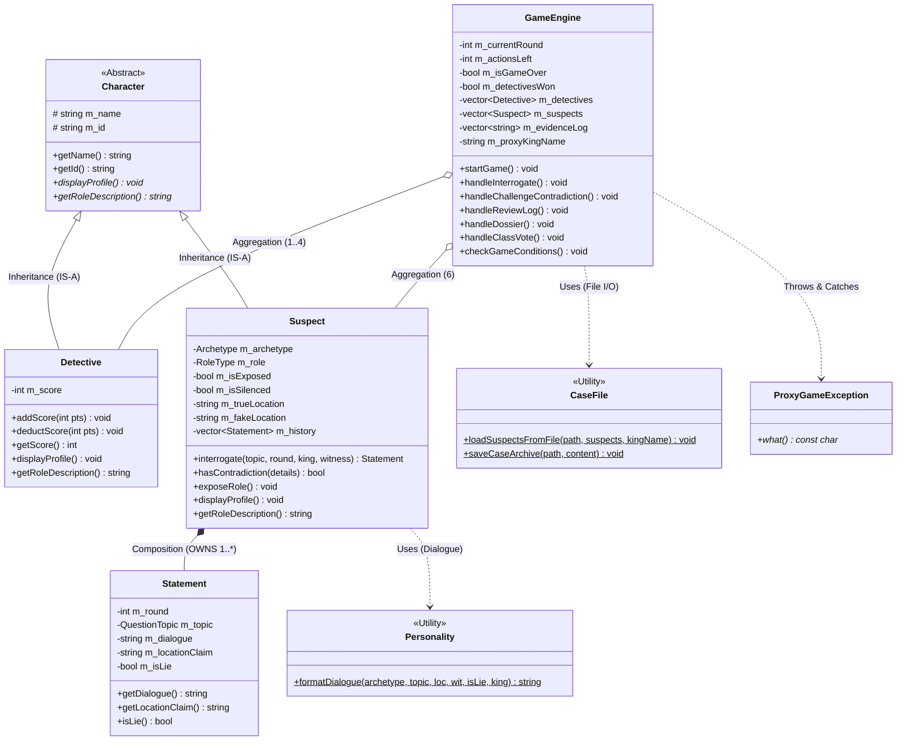
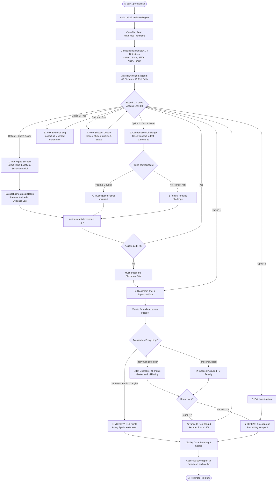

# PROXY DILO KE? — The IUT Attendance Mystery
### CSE 4302: Object Oriented Programming Lab Term Project (C++20)

[](https://en.cppreference.com/w/cpp/20)
[](https://isocpp.org/)
[]()
[]()

---

## 1. Project Overview & Storyline

**"Proxy Dilo Ke? The IUT Attendance Mystery"** is a terminal-based social deduction and forensic investigation game built purely in modern C++ (C++20). 

### The Mystery at Room 302:
During an 8:00 AM class in Room 302, the teacher conducts roll call while looking down at the attendance register. He physically counts **40 students** sitting in the room, but records **45 verbal responses** shout *"Present sir!"*. 

A secret **Proxy Syndicate** operated by an elusive student mastermind—the **Proxy King**—has imitated voices and called fake proxies for 5 absent friends from the back rows!

A squad of **1 to 4 student detectives** (*Saraf, Shifat, Arian, Tamim* or custom names) must interrogate classroom suspects, track alibis across rounds, catch verbal contradictions, and cast an official expulsion vote to unmask the **Proxy King** before Round 4 ends.

---

## 2. Repository File Structure

```
proxy-dilo-ke/
├── Makefile                     # Cross-platform build automation script
├── run.bat                      # 1-click Windows build & execution batch script
├── README.md                    # Project documentation, guides & rubric mapping
├── Project_Proposal_Week4.md    # Official IUT CSE 4302 Week 4 Proposal
├── .gitignore                   # Ignore binaries, object files, and logs
│
├── data/                        # Persistent file storage & configuration
│   ├── case_config.txt          # Suspect data, archetypes, and alibi locations
│   └── case_archive.txt         # Auto-generated audit log archiving past cases
│
├── include/                     # Header files (.h) - Class declarations
│   ├── Character.h              # Abstract base class (Identity & Virtual methods)
│   ├── Detective.h              # Derived human detective class (Score tracking)
│   ├── Suspect.h                # Derived AI student suspect class (Alibis & Lies)
│   ├── Statement.h              # Value class encapsulating dialogue & claims
│   ├── Personality.h            # Banglish dialogue generator for student archetypes
│   ├── CaseFile.h               # File I/O manager (Loading and Archiving)
│   ├── GameEngine.h             # Orchestrator (Round loop, actions, votes, scoring)
│   ├── Enums.h                  # Strongly typed enums (Archetype, Role, Topic)
│   ├── Exceptions.h             # Custom domain exception hierarchy
│   └── TerminalColor.h          # Cross-platform ANSI escape codes for styling
│
└── src/                         # Source files (.cpp) - Class implementations
    ├── Character.cpp            # Character base implementation
    ├── Detective.cpp            # Detective scoring & profile display
    ├── Suspect.cpp              # Interrogation logic & contradiction checker
    ├── Statement.cpp            # Statement getters & immutability
    ├── Personality.cpp          # Authentic IUT student archetype dialogue
    ├── CaseFile.cpp             # std::ifstream / std::ofstream file operations
    ├── GameEngine.cpp           # Main loop, menus, trial vote, deduction logic
    ├── Exceptions.cpp           # Custom exception definitions
    └── main.cpp                 # Safe entry point with global try-catch boundary
```

---

## 3. System Architecture & Flowcharts

### A. Object-Oriented Class Hierarchy & Relationships



---

### B. Game Execution & State Machine Flowchart



---

## 4. Cross-Platform Step-by-Step Installation & Run Guide

### Step 0: Clone the Repository (All Platforms)

Open your terminal or command line and run:
```bash
git clone https://github.com/reza-05/proxy_dk_draft.git
cd proxy_dk_draft
```

---

### A. Windows Installation & Execution

You can run the game on Windows using **Command Prompt (CMD)**, **PowerShell**, **Windows Terminal**, or **VS Code**.

#### Prerequisites:
Ensure you have a C++ compiler supporting C++20 (GCC 10+ via MinGW-w64).
* If you already have `g++` installed (e.g. from Code::Blocks, MSYS2, or w64devkit), verify with:
  ```cmd
  g++ --version
  ```
* *If not installed:* Download [w64devkit](https://github.com/skeeto/w64devkit/releases) (portable single-folder C++ compiler, unzip and add to PATH) or install via MSYS2: `pacman -S mingw-w64-x86_64-gcc`.

#### Method 1: One-Click Execution (Recommended)
Simply double-click **`run.bat`** in the project folder, or run in Command Prompt / PowerShell:
```cmd
.\run.bat
```
*`run.bat` automatically configures UTF-8 encoding (`chcp 65001`), compiles all sources with C++20, and starts the game.*

#### Method 2: Manual Terminal Build & Run
If compiling manually in **PowerShell** or **Command Prompt**:
```powershell
# 1. Enable UTF-8 for ANSI color codes and emojis
chcp 65001

# 2. Compile with C++20 (or C++14 if using older MinGW GCC 6.3.0)
g++ -std=c++20 -Wall -Wextra -Iinclude src/CaseFile.cpp src/Character.cpp src/Detective.cpp src/Exceptions.cpp src/GameEngine.cpp src/Personality.cpp src/Statement.cpp src/Suspect.cpp src/main.cpp -o proxydiloke.exe

# (Legacy GCC 6.3.0 fallback - if C++20 is unrecognized):
g++ -std=c++14 -Wall -Wextra -Iinclude src/CaseFile.cpp src/Character.cpp src/Detective.cpp src/Exceptions.cpp src/GameEngine.cpp src/Personality.cpp src/Statement.cpp src/Suspect.cpp src/main.cpp -o proxydiloke.exe

# 3. Launch game
.\proxydiloke.exe
```

> **Windows Tip:** For best appearance with colors and Unicode boxes, run inside **Windows Terminal** (the default terminal in Windows 11 and modern Windows 10).

---

### B. macOS Installation & Execution

#### Prerequisites:
macOS comes with Clang/LLVM. Verify you have Xcode Command Line Tools:
```bash
xcode-select --install
```
Or if using Homebrew GCC:
```bash
brew install gcc
```

#### Method 1: Using `make` (Recommended)
```bash
make
./proxydiloke
```

#### Method 2: Direct `g++` / `clang++` Compilation
```bash
g++ -std=c++20 -Wall -Wextra -Iinclude src/*.cpp -o proxydiloke
./proxydiloke
```

---

### C. Linux (Ubuntu / Debian / Fedora / Arch) Installation & Execution

#### Prerequisites:
Install standard C++ build tools if not already present:
* **Ubuntu / Debian:**
  ```bash
  sudo apt update
  sudo apt install -y build-essential
  ```
* **Fedora:**
  ```bash
  sudo dnf groupinstall "Development Tools"
  ```
* **Arch Linux:**
  ```bash
  sudo pacman -S base-devel
  ```

#### Method 1: Using `make` (Recommended)
```bash
make
./proxydiloke
```

#### Method 2: Direct Compilation
```bash
g++ -std=c++20 -Wall -Wextra -Iinclude src/*.cpp -o proxydiloke
./proxydiloke
```

---

## 5. Troubleshooting & Common Questions

| Issue | Cause | Solution |
| :--- | :--- | :--- |
| `g++: error: unrecognized command-line option '-std=c++20'` | Your GCC compiler is older than version 10 (e.g. GCC 6.3.0). | Either: 1) Compile with `-std=c++14`, 2) Run `run.bat` (which automatically detects your GCC and falls back to C++14), or 3) Upgrade GCC via w64devkit. |
| Boxes or question marks `?` appear in terminal (Windows) | Console code page is set to legacy ASCII. | Run `chcp 65001` before launching, or use `run.bat` which handles it automatically. |
| `fatal error: include/CaseFile.h: No such file or directory` | Executing the command from outside the project root directory. | Make sure you `cd proxy_dk_draft` first, and keep the `-Iinclude` compiler flag. |
| Missing `case_config.txt` error | Config file was deleted or moved. | The game engine features **self-healing auto-fallback**: if the file is absent, it automatically writes a fresh default config file and continues. |

---

## 6. Class Descriptions & Responsibilities

| Class Name | Header / Source | Purpose | Key Fields | Key Methods |
| :--- | :--- | :--- | :--- | :--- |
| **`Character`** | `Character.h` / `Character.cpp` | Abstract base class establishing character identity. | `m_name`, `m_id` | `getName()`, `displayProfile() = 0`, `getRoleDescription() = 0` |
| **`Detective`** | `Detective.h` / `Detective.cpp` | Derived from `Character`. Represents a human investigator. | `m_score` | `addScore()`, `deductScore()`, `displayProfile() override` |
| **`Suspect`** | `Suspect.h` / `Suspect.cpp` | Derived from `Character`. Represents automated student suspects. | `m_archetype`, `m_role`, `m_isExposed`, `m_history`, `m_trueLocation`, `m_fakeLocation` | `interrogate()`, `hasContradiction()`, `exposeRole()`, `displayProfile() override` |
| **`Statement`** | `Statement.h` / `Statement.cpp` | Encapsulates a single question-and-answer record. | `m_round`, `m_topic`, `m_dialogue`, `m_locationClaim`, `m_isLie` | `getDialogue()`, `getLocationClaim()`, `isLie()` |
| **`Personality`** | `Personality.h` / `Personality.cpp` | Formats realistic dialogue responses based on student archetypes (CR, Backbencher, etc.). | N/A (Static Utility) | `formatDialogue()` |
| **`CaseFile`** | `CaseFile.h` / `CaseFile.cpp` | Handles File I/O for loading suspects and archiving results. | N/A | `loadSuspectsFromFile()`, `saveCaseArchive()` |
| **`GameEngine`** | `GameEngine.h` / `GameEngine.cpp` | Coordinates the game loop, menus, action points, and scoring. | `m_detectives`, `m_suspects`, `m_evidenceLog`, `m_currentRound` | `startGame()`, `handleInterrogate()`, `handleClassVote()` |

---

## 7. Object-Oriented Principles (CSE 4302 Rubric Compliance)

1. **Inheritance (IS-A):**
   - Abstract Base Class: `Character` (encapsulating general attributes: `m_name`, `m_id`).
   - Derived Classes: `Detective` (specialized with scores and investigator capabilities) and `Suspect` (specialized with archetypes, roles, alibis, and interrogation history).
2. **Polymorphism:**
   - Pure virtual functions declared in `Character`: `virtual void displayProfile() const = 0;` and `virtual std::string getRoleDescription() const = 0;`.
   - Overridden dynamically by `Detective` and `Suspect` at runtime.
3. **Encapsulation & Data Hiding:**
   - All state fields are strictly `private` or `protected`.
   - Const-correctness implemented across all non-mutating functions (e.g. `getName() const`, `displayProfile() const`).
   - Zero global variables; all application state is owned and managed by `GameEngine`.
4. **Exception Handling:**
   - Custom exception hierarchy rooted at `ProxyGameException` (derived from `std::exception`).
   - Specific exceptions: `InvalidInputException`, `FileNotFoundException`, `SuspectUnavailableException`, `GameOverException`.
   - Handled via hierarchical `try-catch` blocks preventing raw crashes.
5. **File I/O & Persistence:**
   - Reads external configuration from `data/case_config.txt` via `std::ifstream`.
   - Persistent append logging to `data/case_archive.txt` via `std::ofstream`.
6. **Memory Management & RAII:**
   - Follows modern C++ resource management (RAII) using standard library containers (`std::vector`, `std::string`, streams).
   - Zero naked raw pointers, zero memory leaks.

---

## 8. Authors & Contributions

* **Saraf**: Narrative, Dialogue & File I/O (`Personality`, `Statement`, `CaseFile`).
* **Md. Shifat Reza**: Contradiction Validation Logic, Scoring Balance, and Investigation Flow.
* **Arian**: Engine Orchestration & Exceptions (`GameEngine`, `Exceptions`, `TerminalColor`, `main.cpp`, `Makefile`, `run.bat`).
* **Tamim**: Character Domain & OOP Hierarchy (`Character`, `Detective`, `Suspect`).
